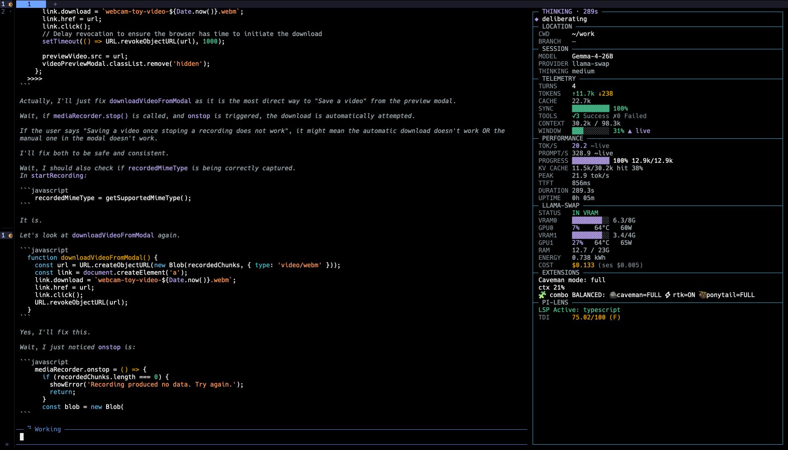

# Pi Side Panel

A Pi TUI extension that replaces the default footer and Pi-Lens widget with a right-hand side panel for session, model, token, performance, Git, and local inference status.

This extension was extracted and adapted from the side panel in [b-iurea/pi-magi-theme](https://github.com/b-iurea/pi-magi-theme).

## Screenshot



## Install

Install the published Pi package for persistent use:

```bash
pi install npm:pi-sidepanel
```

To try it for one invocation without adding it to Pi's settings:

```bash
pi -e npm:pi-sidepanel
```

For local development, load the extension source directly:

```bash
pi --extension ./extensions/sidepanel.ts
```

The package contains the TypeScript source; Pi loads it directly and supplies its Pi runtime dependencies. The panel is available in TUI mode. Non-interactive modes continue to work without rendering terminal UI.

## Panel sections

- **Status** — current agent phase, tool activity, model loading, and context-compaction state.
- **LOCATION** — home-relative `CWD` path and Git branch. Long paths marquee-scroll.
- **PI-LENS** — detected languages, the current file being processed, and Pi-Lens LSP/status information. Long status and file lines marquee-scroll.
- **SESSION** — model, provider, and thinking level.
- **TELEMETRY** — turns, token totals, cache reads, API cost, tool success rate, context-window usage, and hygiene counters.
- **PERFORMANCE** — generation speed, prompt speed, KV-cache hit rate, TTFT, duration, and uptime.
- **LLAMA-SWAP / NINFER** — model health, VRAM/GPU/RAM metrics, throughput, energy, and cost when the active provider supports them.

The extension hides the normal Pi footer and the Pi-Lens `belowEditor` widget so this information is presented in the side panel instead. `/sidepanel off` restores Pi's built-in header and footer for the rest of the session.

## Commands

```text
/sidepanel panel              Toggle the panel
/sidepanel compact            Toggle compact mode
/sidepanel width 48           Set panel width immediately
/sidepanel width reset        Restore the default width
/sidepanel status             Show the llama-swap activity report
/sidepanel cost               Set electricity price and currency
/sidepanel off                Disable side-panel chrome for the session
```

Panel width is clamped to `28–72` columns and saved automatically. Pi's TUI does not expose a native drag-resize handle, so resizing is command-based.

## Configuration

Optional configuration is read from:

```text
~/.pi/agent/sidepanel.json
```

Example:

```json
{
  "ui": {
    "compact": false,
    "panelWidth": 42,
    "kwhPrice": 0.18,
    "currency": "USD"
  },
  "ninfer": {
    "urls": ["http://127.0.0.1:8000"],
    "apiKey": "optional-api-key"
  }
}
```

`ninfer.urls` enables model discovery and registration for NInfer-compatible OpenAI endpoints. The extension also persists model load times and energy totals in this file.

## Requirements

- Pi 1.1.0 or newer with TUI extension support
- Node.js 22.19 or newer
- Optional: Pi-Lens, llama-swap, or NInfer for their additional panel sections

## Development

Install the development dependencies and run the checks before packing:

```bash
npm install
npm run check
npm run pack:check
```

There is no separate build step. The published package intentionally contains `extensions/sidepanel.ts`, because Pi's package loader evaluates TypeScript extensions directly.

## License

MIT. See [LICENSE](LICENSE).
